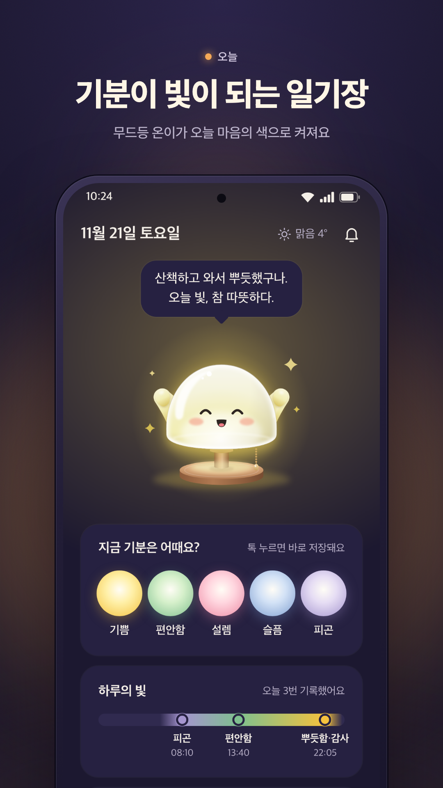
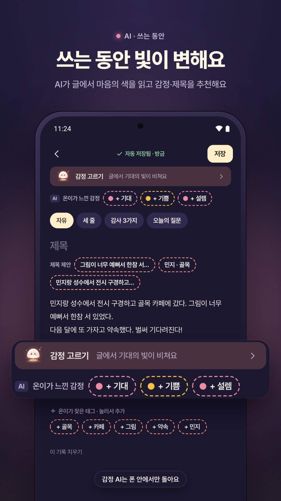
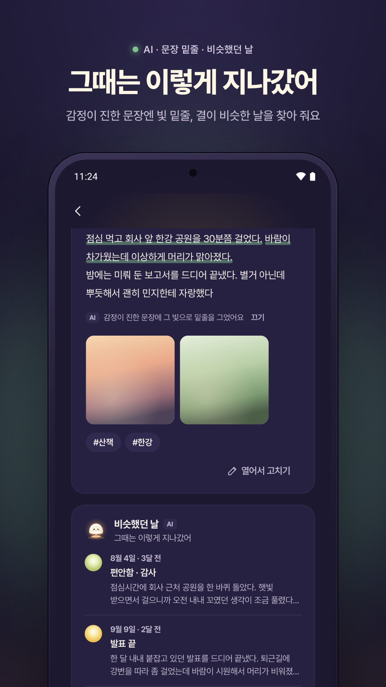

# 온이 일기 — 기분이 빛이 되는 AI 감정일기

일기를 쓰는 동안 AI가 글에서 마음의 색을 읽고, 무드등 「온이」가 그 빛으로 켜지는 감정일기·무드트래커예요.

- Android: https://play.google.com/store/apps/details?id=com.pass.diary
- 웹: https://jungwoogeon.github.io/Diary/

<p>



</p>

## 주요 기능

- **감정 AI (기기 안에서 실행, 약 15MB)**
  - 쓰는 동안 빛이 바뀌어요.
  - 감정, 제목, 태그를 추천해요.
  - 감정이 진한 문장에 밑줄을 그어요.
  - 결이 비슷했던 날을 찾고, 단어가 달라도 뜻으로 검색해요.
  - 리포트에서 "이번 달의 한 줄"을 골라요.
  - 일기는 AI 서버로 보내지 않아요.
- **사진·글자 AI (ML Kit)**
  - 종이 일기를 찍으면 글자로 옮겨요(한국어 OCR).
  - 사진을 보고 태그를 제안해요.
  - 사진에서 사람이나 물건만 오려 스티커로 붙여요.
  - 손글씨로 쓸 수 있어요.
- **기록**
  - 1탭 기분 기록과 위젯
  - 감정 20가지를 강도와 함께 골라 빛을 섞어요.
  - 말로 쓰기, 질문에 답하며 쓰기
  - 저장하면 "온이의 한마디"가 와요.
- **돌아보기**
  - 무드 캘린더와 하루의 빛
  - 월간 리포트, 감정 원인 찾기
  - 주간 온이 편지, 마음 예보
  - 공유 카드, 빛 수집
- **안심**
  - PIN·지문 잠금
  - 내 Google 드라이브 앱 전용 공간에 자동 백업
  - 웹 동기화
  - 휴지통 30일, 내보내기
  - 위기 표현을 감지하면 도움받을 곳을 안내해요.
- **수익**
  - 광고는 적게 넣고, 작성 화면에는 넣지 않아요.
  - 프리미엄은 평생 ₩3,300 한 번 결제예요. 앱에서 사면 같은 Google 계정으로 로그인한 웹에도 적용돼요.
  - AI 기능은 모두 무료예요.

## 구조 (모노레포)

```
app/            Android 앱 진입점 (Kotlin, Jetpack Compose, Hilt)
core/           ai · data · sync · billing-ads · security · vision · reminder · designsystem …
feature/        today · write · calendar · report · my
web/            웹 앱 (TypeScript, React, Vite, PWA) → GitHub Pages
server/         oni-api (TypeScript, Cloudflare Workers): 웹 로그인 유지, 결제 확인·계정 연결
shared/         앱과 웹이 함께 읽는 데이터: 감정 모델, 태그 사전, 위기 감지 규칙, 문장, 일기 스키마, 테스트 데이터
store/          Play 스토어 자료, 개인정보처리방침·데이터 보안 기록
docs/v2/        기획·설계 문서 (AI_GROWTH.md, SERVER.md …)
tools/          모델 학습·평가 스크립트
_v1/            예전 v1 코드 (참고용)
```

`shared/`는 코드가 아니라 데이터예요. Android는 빌드할 때 assets로 넣고, 웹은 Vite에서 바로 불러와요. 같은 규칙을 Kotlin과 TypeScript로 따로 구현하고, `shared/fixtures`로 두 구현이 같은 결과를 내는지 확인해요.

## 데이터와 개인정보

- 일기는 기기와 사용자 Google 드라이브의 앱 전용 공간(`drive.appdata`)에만 저장돼요.
- 서버(oni-api)는 다음 세 가지만 다뤄요. 일기 내용은 받지 않아요.
  - 웹 로그인 유지
  - Play 결제 확인
  - 계정 연동 해제
- 개인정보처리방침: https://jungwoogeon.github.io/Diary/legal/privacy.html

## 개발

```bash
# Android
./gradlew :app:assembleDebug
./gradlew testDebugUnitTest

# 웹
cd web && npm ci && npm run dev      # npm test, npm run build

# 서버
cd server && npm ci && npm test      # 배포: npx wrangler deploy (README 참고)
```

출시 서명에는 `keystore.properties`(저장소에 넣지 않아요)가 필요해요.
